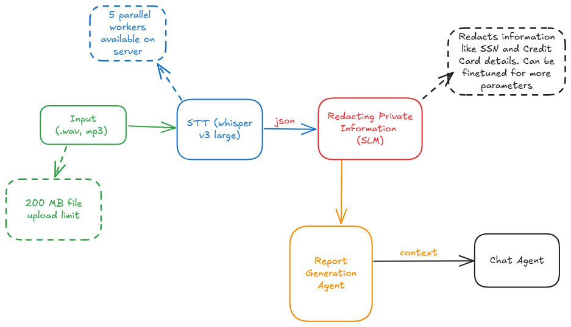

<p align="center">
  
</p>

<h1 align="center">Voicel</h1>

<p align="center">Voicel is a prototype for customer-support audio processing. The Streamlit app in <code class="notranslate">src/main.py</code> sends audio to a transcription API, requests text sanitization, creates a report, and exports the report as PDF. The FastAPI service is in <code class="notranslate">server/server.py</code>.</p>

The sanitizer prompt targets U.S. Social Security numbers and payment card numbers. It does not target other personal data.

## Flow

1. The user selects audio files in the Streamlit app.
2. The app sends the files to the configured `WHISPER_URL` endpoint.
3. The app sends each transcript to `SANITIZE_URL`.
4. The app generates a report and can export it as PDF.



## Setup

The project uses Python `3.13+` and `uv`. Install the project dependencies from the repository root:

```bash
uv sync
```

Create a root `.env` file with the settings that `src/config.py` requires:

```env
GROQ_API_KEY=your_groq_key
GEMINI_API_KEY=your_gemini_key
WHISPER_URL=http://localhost:8000/transcribe-batch
SANITIZE_URL=http://localhost:8000/sanitize
LOGFIRE_KEY=your_logfire_key
```

Start the Streamlit app from the repository root:

```bash
uv run --with groq streamlit run src/main.py
```

## API service

The FastAPI service defines `/transcribe-batch`, `/sanitize`, and `/ping` in `server/server.py`. It loads Whisper large-v3 and Qwen2.5-3B when the module starts. It uses CUDA when available and otherwise selects CPU.

The project manifest does not list all API imports, including `logfire`, `transformers`, `uvicorn`, `accelerate`, and `python-multipart`. The command below supplies those packages for this run. The service can download large model files at startup.

Start the API from the repository root. The command supplies the missing packages for this run:

```bash
PYTHONPATH=src uv run --with logfire --with transformers --with uvicorn --with accelerate --with python-multipart uvicorn server.server:app --reload --host 127.0.0.1 --port 8000
```

The API source sets `HF_HOME` to `/home/guest/lv02/hf_cache`. This cache path is specific to one host.

## API contract

`src/main.py` expects the transcription endpoint to return `{"transcriptions": [...]}`. The tracked `server/server.py` endpoint returns `{"results": [...]}`. The client and server response shapes do not match.

## Source files

- `src/main.py` — Streamlit app.
- `src/version_2.py` — alternate Streamlit implementation.
- `src/config.py` — environment settings.
- `server/server.py` — FastAPI service.
- `assets/arc.png` — architecture diagram.

## License

This repository uses [CC0 1.0 Universal](LICENSE).
